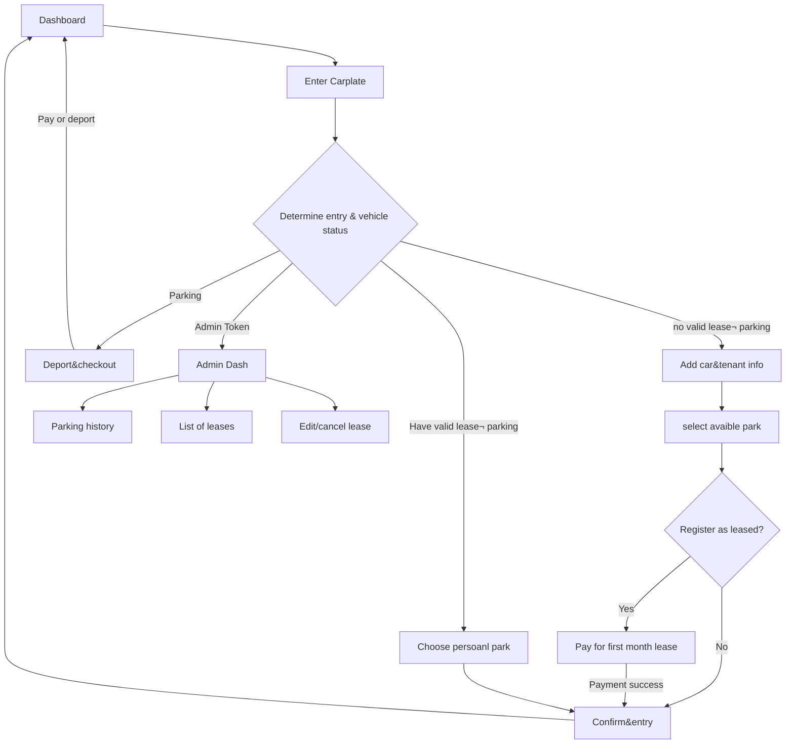

# SmartPark：C# GUI project for parkinglot management


## 1. Quick Start

Requires the .NET 9 SDK; the first restore requires access to NuGet. The target framework is the same as the prototype: `net9.0`.

When running the function, the program automatically create sqlite DB with 12 Demo spaces.

- Default administrator password: `@admin`, exact match, case-sensitive.
- Example spaces: A01–A12, including regular/EV and small/large spaces.
- Amounts are internally `long` Australian cents, for example `20000` = `$200.00`.
- Model times use Unix seconds; DTO times use UTC `DateTime`; the View converts them to local time for display.
- All source files are uniformly UTF-8, supporting future i18n
### 1.1 Temperate Car:
- Arrival: Dashboard->Input carplate->Input `IsEV`/`IsBig`->Select a car park(the recommended space is selected bydefault; if no space available return not available)->Done
- Deport: Dashboard->Input carplate->go to checkout page->done
### 1.2 Register as tenant upon arrival:
- Arrival: Dashboard->Input carplate->Input `IsEV`/`IsBig`/`register as tenant`->Input contact info->Select a car park->checkout to pay for first month->Done
- Deport: Dashboard->Input carplate->checkout page with 0 fee->done
### 1.3 Registered tenant arrival:
- Arrival: Dashboard->Input carplate->Done
- Deport: Dashboard->Input carplate->Done
### 1.4 Administration
- Login: Dashboard->Input carplate with token(`@admin` by default)
- Parking History: admin dashboard(logged in)->tab Parking History
- Show Leases: admin dashboard(logged in)->tab Leases
- Cancel lease:admin dashboard(logged in)->tab Leases->select a lease and click cancel lease

## 2. Project Responsibilities and MVC Boundaries

| Project/Directory | Responsibility |
|---|---|
| `Parking.Core/Models` | Retains the four entities Vehicle, ParkingSpace, ParkingSession, and Lease, along with their original fields |
| `Parking.Core/DTOs.cs` | View input and return snapshots; EF-tracked entities are not handed to the View |
| `Parking.Core/ServiceInterfaces.cs` | Business service, billing, recommendation, and clock interfaces |
| `Parking.Core/ViewInterfaces.cs` | `IShellView`: implemented by the main window for page switching |
| `Parking.Controllers` | Controllers for eight pages; save the current user's workflow drafts and coordinate navigation |
| `Parking.Application` | Business validation, recommendation, billing, settlement, and lease cancellation |
| `Parking.Application/Persistence` | EF Core DbContext, SQLite table creation, and seed data |
| `Parking.Demo` | A compilable and runnable Controller integration example with no GUI |
| `Parking.Tests` | NUnit: fee boundaries, lifecycle, rollback, concurrent space selection, and Controller flows |
| `Parking.WinForms` | View methods and controllers |
| `Parking.WinForms/Controls` | Internal controller of view for showing the car parks or the changes |
| `Parking.WinForms/Screens` | Detailed design of the screens of views |

Dependency direction: View → Controller → `IParkingApplicationService` → business services/EF Core → SQLite.


Controllers do not read DbContext and do not directly modify entities; business services create a short-lived DbContext for each operation. The hourly-rental and long-term-lease implementations of `IFeePolicy` demonstrate polymorphism with actual use; LINQ uses lambdas; DTOs use generic collections and `OperationResult<T>`.


## 3. Final Adopted Business Rules

### 3.1 Entry, Exit, and Temporary Storage

1. The user enters a license plate; first check for an ongoing `ParkingSession`, then check for a valid lease.

2. Vehicles currently on site enter the checkout page; tenants with no on-site record can only select their own space; other vehicles expand the supplementary information.

3. Supplementary information is stored only in the workflow DTO and is not written to Vehicle in advance.

4. For temporary vehicles and existing tenants: after confirming the space, create the Vehicle and `ParkingSession` and update the space within a transaction.

5. For new monthly-rental customers: select a space → monthly-rental quote → click payment successful → create the Lease, Vehicle, and `ParkingSession` and update the space within a transaction.

6. Opening the checkout page, refreshing the quote, or canceling UI operations does not end existing parking.

7. Temporary vehicles end the parking record only after clicking "Pay and Exit"; tenants end it only after clicking "Confirm Exit".

8. Both vehicle types delete the Vehicle on exit; parking records and leases are retained permanently.

9. Monthly parking subscriptions are set to auto-renew by default; otherwise, they must be cancelled manually.

### 3.2 Charges

| Type | Regular Space | Large Space |
|---|---:|---:|
| Temporary parking hourly rate | $5.00 | $6.00（+20%） |
| First monthly rental | $200.00 | $240.00（+20%） |
| Existing tenant entry/exit | $0.00 | $0.00 |

We applies the "large-space 20% surcharge" uniformly to hourly rentals and first monthly rentals; charges are based on the selected space, so a small car parked in a large space is also charged the surcharge.

- EV has no surcharge, and no actual charging switch is provided.
- The first 10 minutes are free; after that, the entire parking duration is rounded up to the nearest hour without deducting the free minutes.
- Regular space: 10 minutes $0, 11 minutes $5, 60 minutes $5, 61 minutes $10; large space: $0, $6, $6, $12 respectively.
- At entry, the rate including the large-space surcharge is written to `ParkingSession.HourlyRateCents`.
- The actual duration is recalculated before payment. If the amount changes, return `QuoteChanged`; the View refreshes and requires the user to confirm again and must not automatically charge the new price.
- The payment button simulates successful payment and is not connected to a bank or payment platform.

### 3.3 Leases

- Lease validity is determined only by `Lease.IsActive`
- Monthly rentals remain valid by default; future periodic payments are considered completed, and no monthly bills are automatically generated or charge records repeatedly written.
- There is no lease update, plate change, or space change functionality.
- Canceling a lease sets `IsActive=false` and `CancelledTime`, without physically deleting it.
- If the lease still has a vehicle on site, also set the parking record as ended, `AdminRemoved=true`, record the reason, actual payment 0, and delete the Vehicle.
- After cancellation, clear the space's LeaseID; normal tenant exit only clears SessionID and retains LeaseID.
- No additional charge is applied at cancellation, and no refund is implemented.

### 3.4 Space Recommendation and Grid

Internal candidate filtering:

- Temporary vehicles/new monthly rentals: the space is enabled and `SessionID == -1 && LeaseID == -1`.
- Existing tenants: the space is enabled, has no vehicle, and matches the Pid/LeaseID of their valid lease.
- Large vehicles cannot park in small spaces; small vehicles can park in large spaces.
- EV and non-EV vehicles can park in each other's spaces.

Recommendation ordering: number of mismatches ascending → `Dest` ascending → `Pid` ascending.
EV mismatch counts as 1 item; a small car occupying a large space counts as 1 item. Match quality takes precedence over distance. Dest is a preset ranking value; this version does not select a destination and does not assume its unit must be meters.

`ISpaceRecommendationService.Recommend()` returns only one `SpaceRecommendation?`; if there are no candidates, it returns `null`. Other spaces are filtered by the business service's internal `Candidates()`. The View receives the complete `SpaceSelectionState.Spaces` and each cell's `CanSelect`, and no separate recommendation list needs to be exposed.

| Condition | DTO.Color | View Color |
|---|---|---|
| Not selectable, including disabled, occupied, another tenant's lease, incompatible | Red | Red |
| Selectable but not selected | White | White |
| Currently selected | Green | Green |
On first entry, the recommended item is selected by default; on refresh, a manual selection that is still valid is retained, otherwise it falls back to the recommended item. `Select(id)` returns the entire new grid, with at most one cell green. Although a tenant's own empty space has Status=Leased and `IsFree=false`, its `CanSelect=true`; do not disable that tenant's space based solely on Status/IsFree.

## 4. Workflow



## 5. View Design

Create only once in Program.cs/application composition entry:

```csharp
var store = new EfParkingStore("smartpark.db");
store.Initialize();
var service = new ParkingApplicationService(store);
var controllers = new ParkingControllers(service, shell); // shell 实现 IShellView
```

Each window has its own set of `ParkingControllers` and `ParkingApplicationService`. Pages share this set of objects. 


| Page | Controller and Public Methods | Main Return Values/Behavior |
|---|---|---|
| Home | `Dashboard.Load()`、`OpenArrival()` | `OperationResult<Dictionary<string,int>>`; navigates to the information entry page |
| Information Entry | `Arrival.SubmitPlate(input)`、`SubmitDetails(request)` | `ArrivalDecision`；`MoreInformation` the View expands the form; other paths navigate automatically |
| Space Selection | `SpaceSelection.Load()`、`Select(spaceId)`、`Next()` | Grid DTO; default/manual selection; submits entry or proceeds to first monthly-rental checkout |
| Checkout | `Checkout.Load()`、`Confirm()`、`Cancel()`、`Done()` | Quote, receipt; after success, the View displays the receipt, then Done returns to Home |
| Management Home | `Management.Load()`、`Open(screen)`、`Logout()` | Checks the administrator session; navigates to History/LeaseList/LeaseCancellation |
| History Page | `History.Load()` | All parking records (including ongoing), newest entry records first |
| Lease List | `LeaseList.Load()` | All leases (valid and canceled), including name, contact information, address, etc. |
| Lease Cancellation | `LeaseCancellation.Load()`、`Select(id)`、`Cancel(id)` | Valid lease list, selected details, cancellation result |
| Global Back | `controllers.Home()` | Discards UI drafts and quotes, exits the administrator session, returns to Home |

Checkout Button Text
| `CheckoutKind` | Button |
|---|---|
| TemporaryExit | Pay and Exit (still requires confirmation when free) |
| TenantExit | Confirm Exit |
| FirstLeasePayment | Pay Monthly Rent and Enter |

## 6. SQLite Data and Transactions

Tables are created by EF based on DbSets: `Vehicles`, `Spaces`, `Sessions`, `Leases`, `Settings`.

- Primary keys are explicitly configured as Carplate, Pid, Sid, and Lid; integer primary keys are generated by SQLite.
- `ParkingSpace.Status` is a computed property and is not stored in the table; `IsFree` is uniformly maintained by the business workflow.
- Unique partial indexes prevent two valid leases or two on-site records for the same license plate/space.
- Entry, first monthly-rental payment, exit, and lease cancellation are each completed within a database transaction.
- Leases and parking records have restrictive-delete foreign keys to the space's Pid.
- `EnsureCreated()` is used for first-time table creation. Database migrations are not included; after modifying entity structures, do not expect it to automatically upgrade old databases. For demos, back up and switch to a new database path; real data should add EF Migrations.

## 8. Technical References

- EF Core transactions：https://learn.microsoft.com/en-us/ef/core/saving/transactions
- SQLite Provider：https://learn.microsoft.com/en-us/ef/core/providers/sqlite/
- EnsureCreated：https://learn.microsoft.com/en-us/ef/core/managing-schemas/ensure-created
